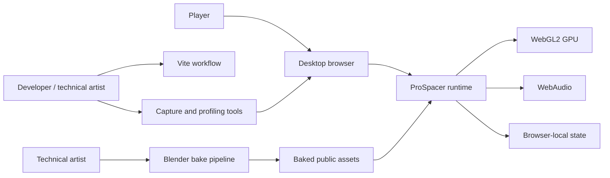
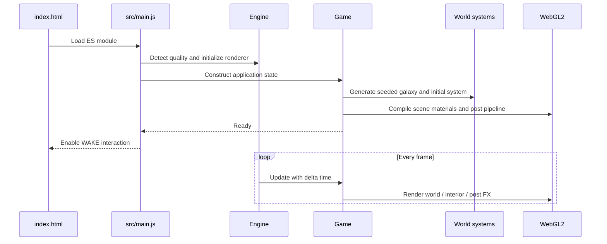
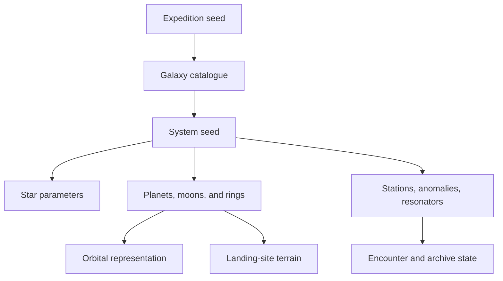
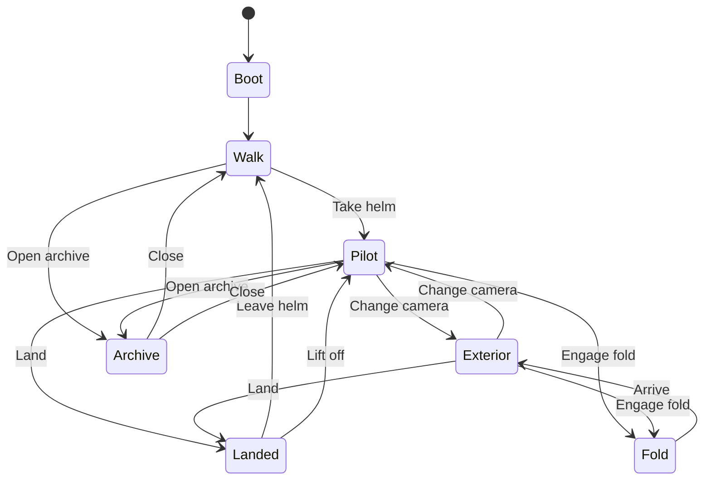

# ProSpacer Architecture

This document defines the current technical boundaries of ProSpacer and the invariants future enhancements should preserve. It is an engineering map, not a substitute for the code.

## Architectural goals

- Sustain a responsive desktop WebGL2 experience across varied GPU classes.
- Keep world generation deterministic from explicit seeds.
- Represent cockpit-scale and astronomical-scale objects without visible precision failure.
- Make expensive visual work measurable and reproducible.
- Keep rendering, simulation, content, and presentation separable enough to evolve safely.
- Ship as static browser assets with no mandatory application server.

## System context



## Runtime boot sequence



## Module boundaries

| Area | Owns | Must not own |
|---|---|---|
| `src/core` | Renderer creation, quality selection, input normalization, frame scheduling | Narrative or world-specific rules |
| `src/game` | Progression, orchestration, encounters, directives, lore, cutscenes | Low-level rendering utilities |
| `src/gfx` | Shared GLSL, post-processing, sky, cubemap baking, construction/surfacing helpers | Progression state |
| `src/world` | Deterministic systems, celestial bodies, structures, terrain, fleets | DOM UI |
| `src/ship` | Vessel geometry, flight/player behavior, interior, cockpit displays | Galaxy generation |
| `src/ui` | Screen-space HUD and archive presentation | World simulation |
| `src/audio` | Procedural soundtrack, interface cues, propulsion audio | Input mapping |
| `tools` | Verification, profiling, capture, asset generation | Production runtime dependencies |

## Coordinate and precision model

One world unit represents one kilometre. The player remains near the origin while world objects are positioned relative to the player. This floating-origin rule is foundational:

1. Author durable world positions in the game-state coordinate model.
2. Convert to player-relative render positions at the scene boundary.
3. Never accumulate long-running camera motion in large absolute Three.js coordinates.
4. Ensure custom shader materials include the shared logarithmic-depth path when they can overlap at astronomical ranges.

A feature that bypasses these rules may look correct near the origin and fail during flight or fold transitions.

## Generation model

Galaxy and system generation use seeded pseudo-random streams. A content feature should derive randomness from a stable seed and avoid frame-order-dependent random calls.



Determinism supports save compatibility, reproducible issue reports, scripted captures, and performance comparisons.

## Rendering architecture

### Scene layers

- The orbital scene represents stars, planets, structures, fleet traffic, and the player vessel.
- The interior scene represents the cockpit and walkable cabin.
- The ground scene replaces the orbital planet sphere with local terrain when landed.
- Screen-space UI remains outside the 3D scene.
- Post-processing consumes scene targets and produces the final display frame.

### Planet rendering

High-frequency procedural planet fields are baked into cubemaps. Runtime planet materials sample the baked result for albedo, height-derived normal response, and lighting. Nearby bodies can receive higher-resolution bakes than distant bodies.

### Surface rendering

The landed surface uses an exponentially spaced radial grid displaced by the same terrain family as the orbital bake. Terrain sampling must remain band-limited to mesh and pixel scale to prevent shimmer and unstable silhouettes.

### Constructed objects

`src/gfx/greeble.js` provides shared material, dressing, plate, seam, truss, emitter, and merge logic. Parts bake transforms into geometry and merge by material to keep draw calls controlled.

### Post-processing

The pipeline performs luminance reduction, temporal exposure adaptation, bloom, anamorphic streaks, light shafts, lens effects, tone mapping, grain, dither, and FXAA. Any new full-screen pass must include a measured GPU cost and a fallback or consolidation strategy.

## State and interaction

`Game` is the primary orchestrator. It owns current mode, system, discoveries, progression, and high-level transitions. Specialized systems update through that authority:



UI panels do not independently mutate simulation state. They request actions through the game object.

## Extension points

### Add a world type

1. Extend deterministic generation data.
2. Add orbital bake and runtime shader behavior.
3. Add landing terrain behavior where applicable.
4. Add archive copy and scanning presentation.
5. Add fixed-seed visual and performance captures.
6. Verify seams, log depth, exposure, and low-quality behavior.

### Add a structure

1. Build from shared construction and material helpers.
2. Merge geometry by material.
3. Publish scanning, targeting, practical-light, and interaction metadata through the established `userData` contracts.
4. Add deterministic placement.
5. Add a survey capture and draw-cost comparison.

### Add an encounter

1. Keep trigger conditions in the encounter/directive layer.
2. Make state transitions idempotent.
3. Store durable outcomes in serializable game state.
4. Route cinematic presentation through `Director`.
5. Add replay and interruption cases.

## Architectural invariants

- No feature may depend on a developer-specific absolute filesystem path.
- Generation must remain deterministic for a given seed and versioned rule set.
- Large world positions must cross into rendering through relative coordinates.
- Custom overlap-prone shaders must preserve logarithmic depth.
- Runtime features require a measurable cost on representative hardware.
- A new material or light must justify its draw-call and shader-variant impact.
- Tooling and development-only dependencies must not enter the production bundle.
- Project-owned Markdown must retain the Profexor copyright and ProSpacer™ notice.

## Decision records

Substantial changes should add a short record under `docs/decisions/` using:

```text
Title
Status: proposed | accepted | superseded
Context
Decision
Consequences
Validation
```

Examples include render-pipeline changes, save-format changes, world-generation compatibility changes, or new production dependencies.

## Known evolution areas

- Formalize a versioned save schema before progression expands.
- Separate large shader families into testable composition units.
- Establish representative GPU tiers and checked-in baseline reports.
- Add accessibility settings and remappable input without fragmenting action semantics.
- Define content data schemas before supporting external content packs.

---

ProSpacer™ and its visual identity are trademarks of Profexor. Copyright © 2026 Profexor. The software is licensed under the [MIT License](LICENSE); trademark rights are not granted by the software license.
