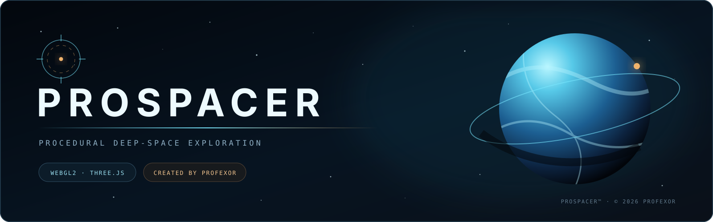
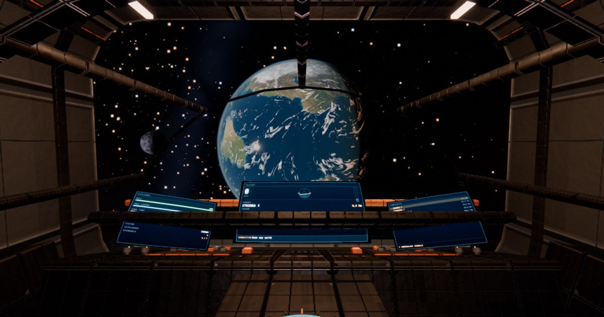
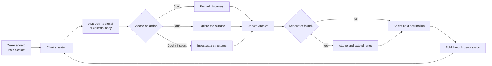
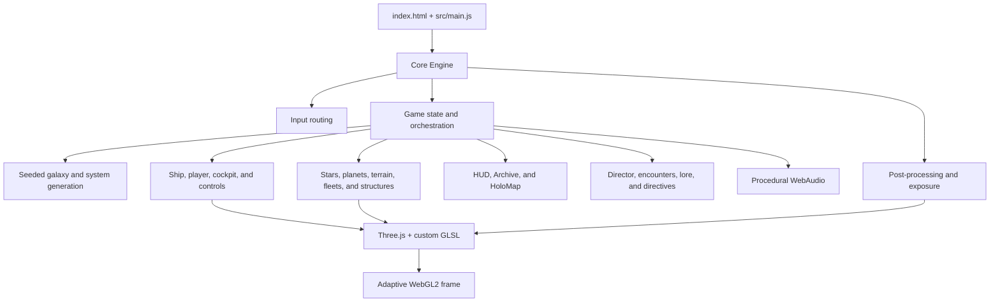
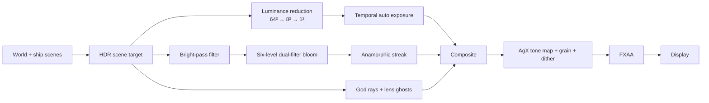
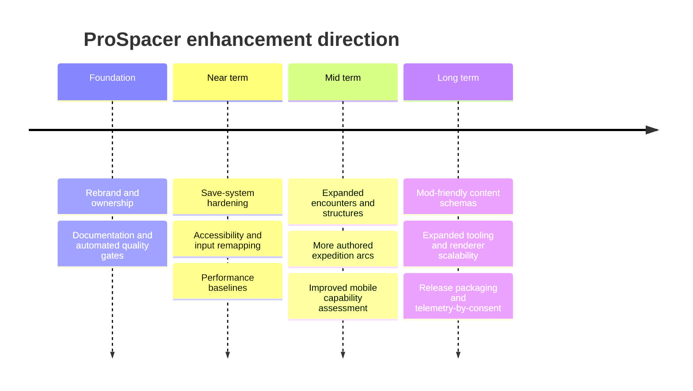

<div align="center">
  
</div>

<div align="center">
  <a href="https://github.com/jennofrie/ProSpacer/actions/workflows/quality.yml"></a>
  
  
  
  
</div>

<p align="center">
  <strong>Explore a living procedural galaxy from the cockpit of the deep-survey vessel <em>Pale Seeker</em>.</strong><br />
  ProSpacer is a browser-native space exploration experience built with Three.js, WebGL2, procedural generation, custom GLSL, and a performance-adaptive render pipeline.
</p>

<p align="center">
  <a href="#experience">Experience</a> ·
  <a href="#gameplay-loop">Gameplay loop</a> ·
  <a href="#technical-overview">Technology</a> ·
  <a href="#quick-start">Quick start</a> ·
  <a href="#project-map">Project map</a> ·
  <a href="#documentation">Documentation</a> ·
  <a href="#roadmap">Roadmap</a>
</p>

---

<div align="center">
  
  <sub>A real frame captured from the running game—not concept art or a static mock-up.</sub>
</div>

## Project snapshot

| Area | Current foundation |
|---|---|
| Runtime | Browser-native ES modules |
| Graphics | Three.js, WebGL2, custom GLSL |
| World | Seeded stars, worlds, moons, rings, stations, fleets, anomalies, and terrain |
| Player experience | Flight, fold travel, scanning, landing, ship traversal, archive, and narrative progression |
| Presentation | Adaptive resolution, HDR-style post-processing, procedural audio, cinematic direction |
| Tooling | Vite, Playwright, capture/profiling scripts, Blender asset-bake pipeline |
| Target | Desktop browsers with WebGL2 and hardware acceleration |
| Creator and maintainer | **Profexor** |

## Experience

Forty thousand years ago, nine hundred inhabited worlds inside an eighty-light-year volume fell silent in four days. Their cities remain lit. Their orbits remain ordered. Seven Resonators wait across seven systems.

You command the *Pale Seeker*, charting systems, scanning celestial bodies, investigating structures, landing on procedural worlds, and attuning the Resonators. Each discovery expands the archive; each Resonator advances the expedition.

### What makes ProSpacer distinctive

- **One seamless role:** pilot, surveyor, explorer, and investigator without changing applications or control metaphors.
- **Seeded worlds:** a deterministic galaxy supports repeatable captures, debugging, and future authored encounters.
- **Planet-scale rendering:** floating-origin coordinates and logarithmic depth keep spacecraft and astronomical bodies stable in the same scene.
- **Procedural surfaces:** stars, terrain, atmospheres, structures, hulls, and effects are driven by geometry and shaders.
- **A physical cockpit:** navigation, archive access, instruments, and ship traversal are grounded inside the vessel.
- **Measured presentation:** exposure, bloom, atmosphere, lighting, draw cost, and image levels have dedicated inspection tools.

## Gameplay loop



<details>
<summary><strong>Desktop controls</strong></summary>

| Action | Input |
|---|---|
| Steer / look | Mouse after pointer capture, or arrow keys |
| Throttle | `W` / `S` or mouse wheel |
| Roll | `Q` / `E` |
| Boost / run | `Shift` |
| Interact | `E` |
| Scan | Hold `F` |
| Land / lift off | `L` |
| Fold drive | `J` |
| Stellar cartography | `M` |
| Archive | `Tab` |
| Full stop | `X` |
| Camera | `V` |
| Frame statistics | `P` |

</details>

<details>
<summary><strong>Touch interface</strong></summary>

The runtime includes twin-stick movement and contextual touch actions for use, boost, scan, automation, and fold travel. ProSpacer remains desktop-first because its full visual feature set is demanding; mobile support should be treated as an optimization track rather than a reduced-design promise.

</details>

## Technical overview

### System architecture



### Frame pipeline



### Engineering highlights

| Challenge | ProSpacer approach |
|---|---|
| Astronomical scale | Floating origin keeps the player near `(0, 0, 0)` while the world moves relatively |
| Depth precision | Logarithmic depth support is wired into custom materials |
| Procedural planet cost | Expensive terrain fields are baked into cubemaps and sampled cheaply at runtime |
| Atmospheres | Single-scattering ray marches with wavelength-shaped Rayleigh response and soft penumbrae |
| Exposure | GPU luminance reduction plus temporal adaptation |
| Dense constructed forms | Geometry is transformed, merged, and welded by material to control draw calls |
| Distant traffic readability | Analytic motion schedules and view-scaled beacons |
| Variable hardware | Dynamic render scale responds to frame-time pressure |
| Reproducibility | Seeded generation and scripted capture/profiling routes |

<details>
<summary><strong>Why floating origin?</strong></summary>

A system spans millions of world units while the ship is roughly a tenth of a unit long. Large absolute coordinates destroy the precision needed for cockpit-scale motion. ProSpacer keeps the player at the origin and positions everything else relative to that origin each frame.

</details>

<details>
<summary><strong>Why cubemap planet baking?</strong></summary>

Evaluating many octaves of procedural terrain for every visible planet fragment is prohibitively expensive. The planet field is rendered into cubemap faces, keeping seams and polar behavior controlled while moving the runtime workload to a small number of texture samples.

</details>

<details>
<summary><strong>Why analytic traffic?</strong></summary>

Traffic follows deterministic paths keyed to time. Ships remain correct after fold jumps, pauses, and scene transitions without running an expensive persistent simulation for distant craft.

</details>

## Quick start

### Requirements

- Node.js `20.19+` or `22.12+`
- npm
- A desktop browser with WebGL2 and hardware acceleration

### Run locally

```bash
git clone https://github.com/jennofrie/ProSpacer.git
cd ProSpacer
npm ci
npm run dev
```

Open [http://localhost:5173](http://localhost:5173).

### Production build

```bash
npm run check
npm run preview
```

The optimized static build is written to `dist/`.

### Command reference

| Command | Purpose |
|---|---|
| `npm run dev` | Start the Vite development server |
| `npm run build` | Create an optimized production bundle |
| `npm run preview` | Serve the production bundle locally |
| `npm run check:branding` | Verify license, attribution, trademark notices, and retired-brand removal |
| `npm run check` | Run integrity checks and the production build |
| `npm run smoke` | Run a browser smoke pass against the development server |
| `npm run splash` | Capture the social-preview image from the live game |
| `npm run icons` | Regenerate application icons |
| `npm run deploy` | Build and deploy static assets through Wrangler |

## Project map

```text
ProSpacer/
├── .github/                 Repository policy, templates, ownership, and CI
├── docs/                    Architecture and engineering guides
│   └── assets/              README and documentation visuals
├── public/
│   ├── models/              Baked interior and terrain assets
│   ├── og.jpg               Real in-engine social/README frame
│   └── site.webmanifest     Installable web-app metadata
├── src/
│   ├── audio/               Procedural WebAudio score and engine sound
│   ├── core/                Renderer, quality selection, frame loop, and input
│   ├── game/                State, progression, direction, encounters, and lore
│   ├── gfx/                 Post FX, sky, baking, shared GLSL, and surfacing
│   ├── ship/                Vessel, cockpit, interior, player, and holographic UI
│   ├── ui/                  HUD and Archive
│   └── world/               Generation, celestial bodies, terrain, fleets, and structures
├── tools/                   Capture, profiling, review, and asset-pipeline utilities
├── index.html               Application shell and metadata
├── package.json             Runtime and workflow commands
└── vite.config.js           Development and production bundling
```

## Quality and performance

ProSpacer targets a stable 60 FPS experience by adjusting render resolution before removing visual features. Quality selection considers the device and renderer; runtime scaling responds to sustained frame-time pressure.

The tool suite supports:

- scripted interaction assertions;
- repeatable set-piece screenshots;
- frame-rate and draw-call surveys;
- render-pass cost inspection;
- ground and atmosphere comparisons;
- image-level and clipping analysis;
- contact-sheet generation for visual review;
- repeatable trailer and marketing captures.

See [Performance Engineering](docs/PERFORMANCE.md) for budgets, profiling practice, and regression gates.

## Documentation

| Document | Purpose |
|---|---|
| [Architecture](ARCHITECTURE.md) | Runtime boundaries, data flow, rendering, state, and extension points |
| [Development Guide](docs/DEVELOPMENT.md) | Environment setup, workflows, tools, debugging, and releases |
| [Performance Engineering](docs/PERFORMANCE.md) | Frame budgets, profiling procedure, and optimization priorities |
| [Content Guide](docs/CONTENT_GUIDE.md) | Adding systems, worlds, narrative, structures, and visual content |
| [Roadmap](ROADMAP.md) | Enhancement themes, priorities, and delivery gates |
| [Contributing](CONTRIBUTING.md) | Branch, commit, review, quality, and contribution requirements |
| [Changelog](CHANGELOG.md) | Versioned project history |
| [Security](SECURITY.md) | Supported versions and private vulnerability reporting |
| [Community Standards](CODE_OF_CONDUCT.md) | Collaboration expectations |
| [Trademark Policy](TRADEMARKS.md) | Correct use of ProSpacer™ names and visual identity |

## Roadmap



Roadmap items are directional and pass explicit design, performance, and quality gates before implementation. See the full [ROADMAP.md](ROADMAP.md).

## Contributing

Start with [CONTRIBUTING.md](CONTRIBUTING.md) and [docs/DEVELOPMENT.md](docs/DEVELOPMENT.md). Every change should preserve deterministic generation, keep renderer cost measurable, update relevant documentation, and pass:

```bash
npm ci
npm run check
```

Issue templates are available for bugs, enhancements, and performance regressions. Pull requests include a focused review checklist.

## License and ownership

Copyright © 2026 **Profexor**.

The source code is licensed under the [MIT License](LICENSE). ProSpacer™ and its visual identity are trademarks of Profexor. The MIT License permits use of the software but does not grant rights to use ProSpacer trademarks, logos, or brand presentation. See [TRADEMARKS.md](TRADEMARKS.md).

---

<p align="center">
  <strong>Designed, engineered, and maintained by Profexor.</strong><br />
  <sub>ProSpacer™ and its visual identity are trademarks of Profexor. Copyright © 2026 Profexor. The software is licensed under MIT; trademark rights are not granted by the software license.</sub>
</p>
