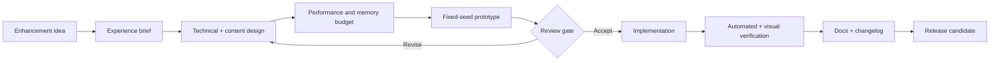

# ProSpacer Roadmap

This roadmap describes enhancement direction for ProSpacer. It is intentionally outcome-based: features enter implementation only when their experience goal, technical design, performance budget, and verification plan are understood.

## Planning principles

1. Preserve the feeling of inhabiting one vessel in one continuous world.
2. Improve depth before adding disconnected breadth.
3. Measure renderer cost before committing visual features.
4. Keep procedural content deterministic and debuggable.
5. Treat accessibility, save safety, and input clarity as product features.
6. Update documentation and verification tools with every system change.

## Status legend

| Mark | Meaning |
|---|---|
| ✅ | Delivered and verified |
| 🚧 | Active or ready for implementation |
| 🧭 | Designed direction requiring specification |
| 🔭 | Longer-term exploration |

## Foundation

- ✅ ProSpacer / Profexor project identity.
- ✅ MIT license and trademark policy.
- ✅ Comprehensive architecture, development, performance, and content documentation.
- ✅ Automated branding-integrity validation.
- ✅ Pull request, issue, ownership, and CI foundations.
- ✅ Portable removal of developer-specific absolute paths.

## Near-term: reliability and accessibility

- 🚧 Versioned save-state schema with migration tests.
- 🚧 Remappable keyboard controls and conflict detection.
- 🚧 Reduced-motion, bloom, grain, and camera-shake settings.
- 🚧 Subtitle scale, contrast, and duration controls.
- 🚧 First-run graphics calibration and clearer unsupported-device messaging.
- 🚧 Representative performance baselines for integrated, mid-range, and high-end GPUs.
- 🧭 Recovery flow for WebGL context loss.
- 🧭 Determinism test fixtures for key galaxy seeds.

### Exit gate

- Save/load survives version migration.
- Critical actions are fully remappable.
- Reduced-motion mode removes nonessential camera and transition movement.
- Baseline scenes stay inside agreed CPU/GPU budgets.

## Mid-term: expedition depth

- 🧭 Expanded encounter grammar with persistent consequences.
- 🧭 Additional Resonator presentation variants.
- 🧭 Derelict and station interaction layers.
- 🧭 More environmental storytelling in orbital and surface sites.
- 🧭 Navigation bookmarks and expedition log filters.
- 🧭 Surface traversal improvements and landing-site variety.
- 🧭 More star, atmosphere, weather, and ring-system families.
- 🧭 Audio mix controls and richer spatial ambience.

### Exit gate

- New content remains deterministic.
- Every new structure has a draw-cost and visual-review capture.
- Progression changes are compatible with versioned saves.
- The archive communicates consequences without external explanation.

## Long-term: scalability and creation

- 🔭 Data-driven content schemas with validation.
- 🔭 Mod-friendly encounter and lore packages.
- 🔭 Offline expedition seed sharing.
- 🔭 Renderer scalability beyond resolution alone.
- 🔭 Optional consent-based diagnostics with no required account.
- 🔭 Release packaging for installable desktop surfaces.
- 🔭 Expanded technical-art bake automation.

## Enhancement pipeline

## Proposal requirements

An enhancement proposal should answer:

- What player problem or opportunity does this address?
- How does it fit the expedition loop?
- Which runtime systems and assets change?
- What is the CPU, GPU, memory, and bundle impact?
- How is determinism preserved?
- What does low-quality behavior look like?
- How will the change be tested and visually reviewed?
- Does it affect saves, input, accessibility, or deployment?

## Definition of done

A roadmap item is complete only when:

- acceptance criteria are met;
- `npm run check` passes;
- interaction or state changes have scripted coverage where practical;
- fixed-seed visual review is complete;
- performance impact is measured;
- relevant docs and changelog are updated;
- Profexor ownership and ProSpacer™ notices remain intact.

---

ProSpacer™ and its visual identity are trademarks of Profexor. Copyright © 2026 Profexor. The software is licensed under the [MIT License](LICENSE); trademark rights are not granted by the software license.
