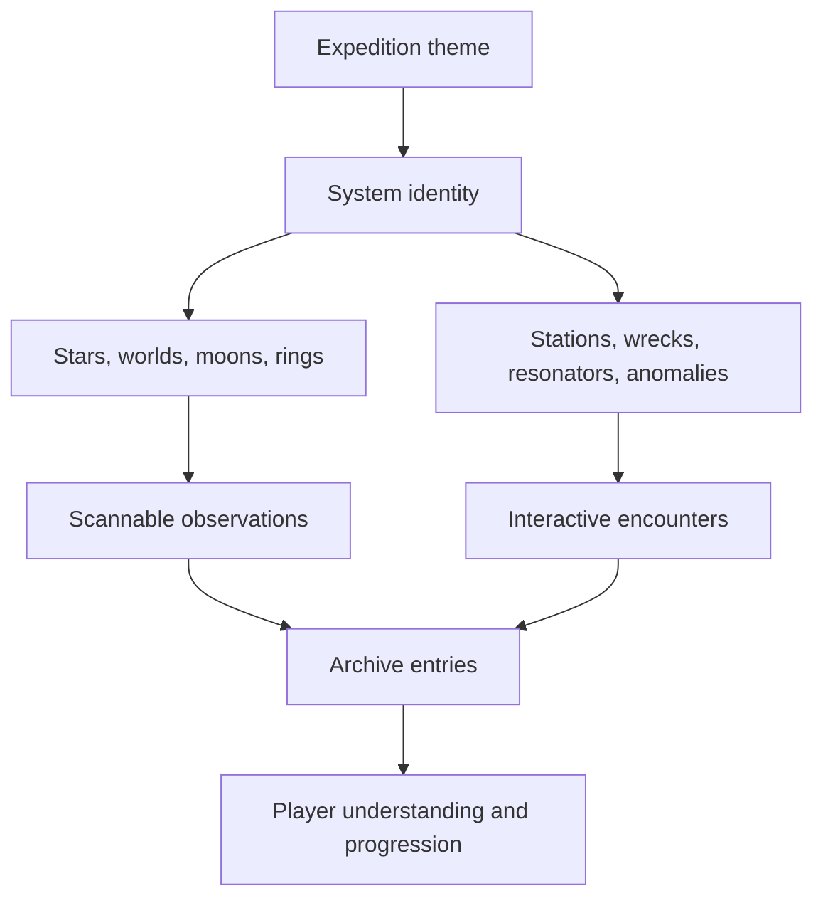

# ProSpacer Content Guide

This guide describes how future worlds, structures, encounters, lore, and visual content should enter ProSpacer without fragmenting its procedural logic or performance model.

## Content principles

- Every discovery should change what the player understands, can reach, or chooses next.
- Procedural variation needs a readable identity, not noise for its own sake.
- Authored moments should compose with deterministic systems.
- Distant forms need clear silhouettes; nearby forms need construction logic and material response.
- Narrative belongs in the vessel, signals, sites, and archive—not in disconnected exposition.
- New content must survive the full range from cockpit display to landed close-up when applicable.

## Content layers

## Adding a celestial-body family

Define:

- generation ranges and stable seed derivation;
- recognizable orbital silhouette;
- palette and physically motivated light response;
- atmosphere, clouds, ocean, rings, or terrain where applicable;
- scan facts and archive language;
- landing support or an explicit reason it is unavailable;
- fixed seeds covering typical and extreme outputs;
- quality-tier and bake-resolution behavior.

Review:

- cubemap seams and poles;
- terminator and eclipse behavior;
- atmosphere at limb and near surface;
- temporal stability during approach;
- exposure across star-facing and night-facing views;
- distant aliasing;
- bake time and memory.

## Adding a structure

Start with function:

1. What was it built to do?
2. Which parts carry load, power, heat, access, and communication?
3. What silhouette communicates that function?
4. What remains active?
5. What can the player scan, approach, or use?

Build through shared construction and material helpers. Avoid disconnected primitive piles; use continuous load paths, joins, recesses, service access, scale references, and deliberate emitters.

### Structure checklist

- Stable generation seed and placement.
- Clear long-range silhouette.
- Controlled draw calls after merging.
- Scan/target metadata.
- Practical lighting metadata when justified.
- Collision or approach constraints.
- Archive entry and interaction state.
- Survey capture at long, medium, and close range.
- Performance comparison.

## Adding an encounter

An encounter specification should include:

| Field | Question |
|---|---|
| Trigger | What deterministic state makes it eligible? |
| Telegraph | How does the player notice it? |
| Choice | What can the player meaningfully do? |
| State | What durable data changes? |
| Interruption | What happens if the player leaves, folds, lands, or reloads? |
| Presentation | Which Director sequence, UI, sound, or structure state communicates it? |
| Archive | What is recorded and when? |
| Replay | Can it repeat, and is repetition intentional? |

Encounter state changes must be idempotent. A cinematic can be interrupted; rewards and progression must not duplicate.

## Writing lore

ProSpacer’s narrative voice is observational, restrained, and specific. Prefer evidence over omniscient explanation.

### Use

- instrument readings;
- material and orbital evidence;
- incomplete records;
- spatial relationships;
- contradictions the player can investigate;
- concise quoted lines for major discoveries.

### Avoid

- explaining the mystery before the player has evidence;
- modern slang that breaks the setting;
- interchangeable poetic abstraction;
- walls of text without a gameplay consequence;
- facts that conflict with deterministic world state.

Every archive entry should answer at least one question and create or sharpen another.

## Visual language

### Ship and constructed surfaces

- Dark, functional materials with readable roughness variation.
- Warm practical accents against cool instrument light.
- Chamfers sized to catch light at the expected distance.
- Panel seams that follow construction rather than random decoration.
- Emitters that have housings, power paths, and local lighting consequences.

### Natural worlds

- Large-scale geological or atmospheric structure first.
- Mid-scale erosion, weather, and circulation second.
- Fine detail only where sampling can support it.
- Palettes tied to material, atmosphere, star spectrum, and exposure.

### UI

- Information appears where the crew would use it.
- Screen-space HUD is reserved for perception and immediate action.
- Typography remains legible under bright planetary and dark deep-space backgrounds.
- Motion communicates state change and respects reduced-motion settings as those are added.

## Audio

New audio should preserve the procedural, diegetic character:

- reserve bright transients for meaningful state changes;
- keep engine response coupled to thrust and mode;
- prevent UI cues from competing with narrative;
- test long sessions for fatigue;
- provide mix controls when adding persistent layers.

## Content review packet

Attach:

- design intent;
- implementation summary;
- representative seeds;
- long/medium/close captures;
- night/day or high/low exposure cases;
- quality-tier comparison;
- draw, triangle, frame, memory, and bundle deltas;
- archive copy;
- interaction and interruption cases.

## Naming

Names should be pronounceable, distinguishable in the archive, and consistent with their origin. Reserve ProSpacer™ brand elements for official project identity. Do not create content names that imply a separate endorsed product without approval from Profexor.

---

ProSpacer™ and its visual identity are trademarks of Profexor. Copyright © 2026 Profexor. The software is licensed under the [MIT License](../LICENSE); trademark rights are not granted by the software license.
