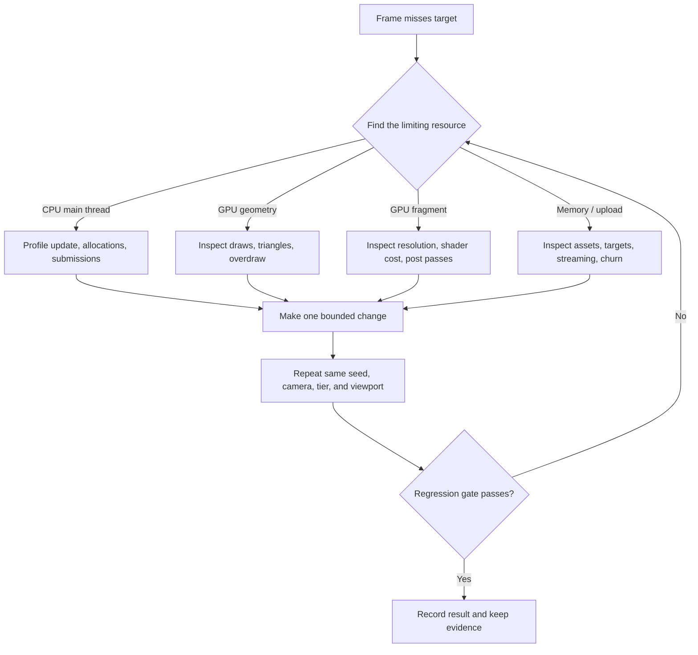

# ProSpacer Performance Engineering

Performance is a design constraint in ProSpacer, not a final cleanup phase. This guide defines how to profile, reason about, and review changes without removing the visual identity of the game.

## Product target

The primary target is a responsive 60 FPS desktop experience:

```text
16.67 ms total frame budget
├── JavaScript update and submission
├── GPU scene rendering
├── post-processing
└── browser/compositor overhead
```

The budget must be measured on representative hardware. A fast development GPU is not a baseline.

## Performance philosophy

- Reduce resolution before silently deleting defining visual features.
- Fix systemic cost before micro-optimizing cold code.
- Prefer deterministic, reproducible scenes for comparison.
- Track CPU and GPU limitations separately.
- Treat draw calls, shader variants, render-target bandwidth, and memory as separate budgets.
- Require evidence for both optimizations and expensive enhancements.

## Adaptive quality

The engine selects an initial quality tier and adjusts render scale according to sustained frame time. The existing range is approximately `0.62×` to `2×`.

Adaptive resolution helps with pixel-bound work, but it cannot fix:

- excessive JavaScript update cost;
- too many draw calls;
- shader compilation stalls;
- large synchronous asset parsing;
- geometry or texture memory exhaustion;
- per-object lighting variant explosions.

Do not use dynamic resolution to hide non-pixel bottlenecks.

## Frame-cost model



## Representative scenes

Maintain fixed captures for:

1. cockpit facing a detailed inhabited planet;
2. exterior vessel near a station and traffic;
3. dense asteroid or structure field;
4. atmospheric limb with post effects;
5. landed terrain with long view distance;
6. fold transition;
7. archive and holographic cartography overlays.

Each scene stresses a different part of the pipeline.

## Measurement protocol

For comparable results:

- use the same commit, seed, system, body, camera, and player mode;
- fix viewport, device pixel ratio, browser version, and quality tier;
- warm shaders before sampling;
- discard startup and transition frames;
- record median and high-percentile frame time;
- record render scale, draws, triangles, texture memory indicators, and browser/GPU identity;
- repeat after a cold load when asset or compilation behavior changes.

## Tooling

```bash
node tools/perfprobe.mjs
node tools/passcost.mjs
node tools/drawcost.mjs
node tools/survey.mjs
node tools/levels.mjs shots/*.png
node tools/leaks.mjs
```

Browser and vendor profilers remain necessary for precise CPU/GPU attribution.

## CPU guidance

### Hot-path rules

- Avoid allocations inside frame loops.
- Reuse Three.js math objects.
- Cache static lookups and generated geometry.
- Update distant or low-value systems at an appropriate cadence.
- Keep DOM work event-driven rather than per-frame.
- Avoid repeated scene traversal when ownership can provide direct references.

### Submission cost

Thousands of inexpensive triangles can be cheaper than hundreds of draw calls. Merge static geometry by material where it does not break interaction, culling, or LOD boundaries.

## GPU geometry guidance

- Use the simplest silhouette that survives the target camera distance.
- Prefer authored bevels where they materially improve highlights; avoid invisible subdivisions.
- Remove unused attributes after generation.
- Share geometries and materials where behavior is identical.
- Evaluate shadow-casting scope separately from visible geometry.
- Keep instancing or merged geometry compatible with scan/selection metadata.

## GPU fragment guidance

- Band-limit procedural noise.
- Exit ray marches when contribution becomes negligible.
- Match sample counts to projected size and quality tier.
- Avoid full-screen passes that can be folded into the composite.
- Watch transparent overdraw in atmospheres, effects, and UI glass.
- Measure render-target formats and bandwidth, not just shader arithmetic.

## Shader variants

Every material feature, light configuration, define, and shadow mode can create variants. Excess variants increase memory and compilation stalls.

Before adding a variant:

1. confirm a uniform branch is not cheaper in the expected workload;
2. confirm the variant is reused enough to amortize compilation;
3. test transition paths that reveal first-use compilation;
4. verify all quality tiers.

## Post-processing review

For a new or changed pass, record:

- input/output resolution and format;
- samples per pixel;
- texture fetch count;
- whether it can share an existing target;
- GPU time at 1080p and one higher resolution;
- low-tier behavior;
- visual comparison with the pass disabled.

## Memory and lifecycle

- Dispose replaced geometries, materials, textures, and render targets.
- Avoid recreating cubemaps or targets on routine state changes.
- Keep baked asset sizes visible in review.
- Test repeated system loads, landing cycles, and archive transitions.
- Use `tools/leaks.mjs` for long-running lifecycle checks.

## Regression gate

A rendering pull request should not merge without:

- production build success;
- fixed-seed before/after captures;
- frame-cost comparison in relevant scenes;
- draw/triangle/pass-cost notes;
- confirmation that adaptive scale is not masking a CPU regression;
- inspection for shimmer, clipping, exposure pumping, shader stalls, and leaks.

## Optimization order

1. Remove work that produces no visible result.
2. Reduce update frequency for low-value distant work.
3. Consolidate draw calls and passes.
4. Reduce samples based on projected contribution.
5. Improve LOD and culling boundaries.
6. Reduce render resolution.
7. Simplify the visual feature only when its experience value no longer justifies its measured cost.

---

ProSpacer™ and its visual identity are trademarks of Profexor. Copyright © 2026 Profexor. The software is licensed under the [MIT License](../LICENSE); trademark rights are not granted by the software license.
